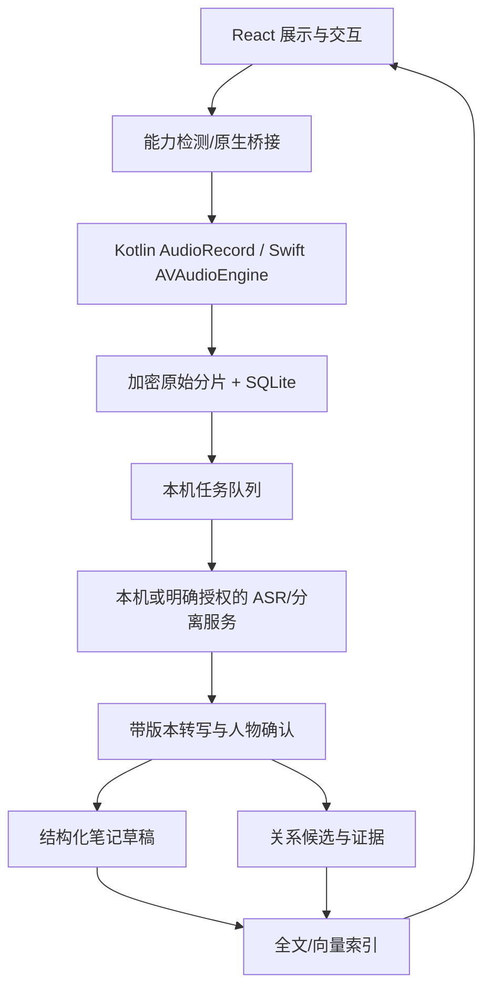

# NEXUS AI 架构与接入说明

本文区分当前浏览器代码、Android 本地宿主与后续真实录音生产架构。目标设计见 [完整产品方案](PRODUCT_DESIGN.md)，交付与安装步骤见 [交付说明](DELIVERY.md)。

## 当前实现

静态单页 React 应用，无应用后端。React 状态驱动页面；业务函数使用 TypeScript；3D 场景通过 React Three Fiber 管理 Three.js 对象。运行 `pnpm build` 后可由静态服务器提供 `dist/`。交付的 `Start-NEXUS.cmd` 使用 `scripts/serve.mjs` 启动仅监听 `127.0.0.1` 的本地静态服务，默认端口 4173；它不是数据或模型后端。

```text
nexus-ai/
  src/
    App.tsx                       页面、选择、录音演示、语言及状态协调
    main.tsx                      React 入口
    domain.ts                     会话、人物、转写、关系与笔记类型
    seed.ts                       虚构人物、会话、笔记和关系证据
    engine.ts                     本地场景规则、笔记抽取及记忆搜索
    storage.ts                    工作空间本地保存及会话删除
    journal.ts                    日记、日历事件类型、排序及 iCalendar 导出
    photos.ts                     图片 Blob 的 IndexedDB 与当前页内存管理
    i18n.ts                       八种界面语言及文案上下文
    native.ts                     检测可信 Android 宿主并调用原生桥
    audio.ts                      合成 WAV 提示音及下载辅助
    adapters.ts                   录音、ASR、分离及模型接入边界
    components/
      RelationshipGraph.tsx       R3F 人物网络与降级入口
      RelationshipGraph.css       图谱标签与降级样式
      JournalPage.tsx             手记、照片、日程、提醒与专注计时
      ProfileSettings.tsx         设置页个人头像与姓名
      SessionEditor.tsx           会话标题、结构笔记、补充文字及附图编辑
  android/                        Kotlin 本地网页宿主、系统选择器与日程调度
  tests/                          领域及适配器验证
  docs/                           设计、架构、Android 验证和限制
  scripts/serve.mjs                使用 Node 提供已构建 dist/ 的本地服务器
  Start-NEXUS.cmd                  Windows 快速启动器
```

`seed.ts` 的初始数据包含 9 个人物、7 场会话及 11 条带来源关系；它们是虚构示例，不是用户账号数据。后续录音演示会话的脚本与人物仍取自示例。日常手记、日程、人物名称/备注及用户选择的图片则允许用户主动创建或修改，不能一概称为虚构数据。

### 当前数据流

```text
初次载入 seed / localStorage
  -> Workspace 状态
  -> 总览、会话库、人物关系网、搜索与隐私设置

模拟录音状态及计时
  -> 选择/生成示例转写
  -> classifyScene（本地关键词规则；录音页可选择演示脚本场景）
  -> generateNotes（提取已有句子，不调用模型）
  -> 演示关系候选
  -> Workspace 更新 -> 按偏好保存至 localStorage

搜索输入 -> 关键词/同义词/人物匹配 -> 返回片段及会话来源
人物/关系选择 -> 显示证据 -> 用户确认 -> Workspace 更新
```

合成提示音由 `audio.ts` 在本机程序生成；它是可播放和下载的 WAV 文件，不是录音器采集的声音。示例转写不对应这个提示音，长会话时间轴与 12 秒提示音不能做音文对齐。

模拟会话结束时，UI 将示例脚本缩放到 `max(模拟计时秒数, 90)` 的展示时长；这是样例时间戳的排布，不是实际听到的话或真实录音时长。会话详情展示本地规则分类及命中原因。搜索结果若有 `segmentId`，点击后会滚动到并高亮该转写；关系证据同样可回到对应片段。这个定位只作用于文本，不会将合成音同步到该句。

`mergeDemoRelations` 仅为显式标记的合成演示会话重放示例关系证据，要求模板引用、说话人、引文和人物端点匹配；它不会仅因同场出现或角色字段而推断新关系。重复证据会去重，新增证据可附到已有关系，用户确认和修正的标签会保留。真实关系抽取尚未接入。

### 实际领域类型

- `Session`：`id/title/date/duration/scene/participants/transcript/notes/tags/audioKind/favorite/isDemo`，并可保存 `userNote` 补充文字与 `photoIds` 附图引用。标题和结构笔记可以编辑；时长与转写 `start/end` 单位为秒；日期为带时区的 ISO 文本。
- `TranscriptSegment`：`id/speakerId/start/end/text`。当前 `speakerId` 是预置人物 ID；目标版应增加会话内匿名说话人与确认绑定层。
- `StructuredNotes`：`summary/keyPoints/decisions/tasks/knowledge/source`。任务包含完成状态与可选负责人；`source` 区分 `demo`、`local-rules` 和 `user-edited`，不是模型生成证明。
- `Person`：名称、关系角色、组织、标签、描述、可选 `memo` 备注、`avatarPhotoId` 本地头像引用和展示颜色；关系引用使用人物 ID，改显示名不必重写历史转写 ID。
- `Relation`：两端人物 ID、标签、置信度、`inferred/confirmed` 状态、来源 `sessionId/segmentId/quote`。
- `MemoryResult`：会话、原文、可选片段 ID 和时间、匹配词及本地排序分数。分数不代表“事实正确的概率”。

产品设计中的 JSON Schema 是后续服务协议建议，字段比原型类型更丰富。当前笔记要点没有逐项 `segmentId`，未实现完整的版本化溯源；关系证据已经单独携带会话和片段来源。

`SessionEditor` 以会话副本编辑标题、结构笔记、待办、补充文字与附图；保存后将笔记 `source` 标记为 `user-edited`，不会更改 `transcript` 或关系引文。当前没有笔记版本历史与跨设备审计。`ProfileSettings` 单独编辑人物 ID 为 `me` 的姓名及头像，显示资料与历史证据的原话分开。

## 本地状态与删除

`storage.ts` 保存 `version: 1` 工作空间至 `nexus-ai-workspace-v1`。核心字段包括 `people/relations/sessions/privacy/language/journal`。加载时验证嵌套字段类型、枚举、唯一 ID、有效时间与数值范围、隐私布尔值、人物引用，以及关系证据对应的会话、片段和引文；日记和日程的时间、图片 ID 与事件时长也纳入验证。非法或无法解析的状态会回到示例工作空间。

对较早的 v1 保存格式，仅在缺少新字段时补入 `language: 'zh'` 和初始 `journal`，保留合法的已有会话、人物和更改。这是有限的增量兼容，不是完整的跨版本迁移、外部文件导入或事务数据库能力。

“在此浏览器记住工作空间”开启时保存当前状态；关闭后移除内容持久化副本，当前页继续使用内存状态，并在独立键 `nexus-ai-persistence-preference-v1` 中仅保留不含正文的 `disabled` 标记。刷新恢复随应用提供的示例，但保持保存关闭，避免刷新后未经用户操作重新保存。清空操作删除当前工作空间内容并关闭保存；因为示例仍随程序分发，刷新仍可重新载入示例。这与服务器数据永久删除、备份销毁无关。

删除单场会话会移除其关系证据，再移除已无证据的关系。人物档案可继续存在。图片清理应以所有仍被引用的日记、会话和头像 ID 为准；编辑中的新图片临时保护，保存后解除草稿标记，取消时移除草稿。清空/恢复还需取消 Android 调度记录。当前没有真实音频文件、向量索引、云端副本或备份需要联动删除。

JSON 导出包括工作空间中的会话、完整示例转写、用户修改的笔记、人物、关系、日常手记文字、日程及偏好；不包含真实录音或图片 Blob。图片在 JSON 中仅保留 `photoIds` 或 `avatarPhotoId`，需单独保留图片备份。生成的提示音单独下载，不保存到 `localStorage`。Android 中 `download()` 将 Blob 转给受限的原生保存文档接口，返回“已打开选择器”不等于文件已经成功写入。

### 日常记录的数据结构

`journal.ts` 定义 `JournalData { entries, events, focusMinutes }`。日记 `JournalEntry` 保存 `id/title/body/createdAt/updatedAt/photoIds`；照片二进制不放入此 JSON。日历 `CalendarEvent` 保存 `id/title/startsAt/durationMinutes/notified`，`startsAt` 必须是带时区的时间点，`notified` 只记录页面内到期提醒状态。初始日记和日历事件也是明确标注的示例；后续用户输入的内容不是示例数据。

`exportEventICS` 生成 `VEVENT`，以 UTC 输出起止时间，包含稳定 UID、时间戳和 `VALARM`；使用 `TRIGGER:PT0S` 表示事件开始时的显示提醒。文本完成换行/分隔符转义，长行按 UTF-8 字节折行。此文件由用户手动导入接收端；日历应用可能忽略外部提醒，系统通知、静音与权限也会影响展示，导出成功不能证明手机会按时响铃。[iCalendar / RFC 5545](https://www.rfc-editor.org/rfc/rfc5545.html)

### 照片、提醒与界面语言

`photos.ts` 使用 IndexedDB 数据库 `nexus-journal-photos` 的 `photos` store 保存 Blob，并在当前页用 Map 缓存。接受 JPEG、PNG、WebP，每张最多 2 MiB；手记及会话各最多 4 张，个人资料保存一张头像。当前没有全工作空间固定的 10 MB 等总量上限，实际容量受浏览器配额和设备可用空间影响。保存开关与写入按队列处理，磁盘写入前检查最新保存策略；编辑草稿照片临时受保护，避免其他记录变化时误删。关闭保存时附件保留在当前页内存，数据库副本会清理；页面关闭后内存消失。此机制没有远端上传或自动移除 EXIF 元数据。

`JournalPage` 在路由切换时保持挂载但隐藏，页面内调度和专注计时可跨产品页面继续。到期检查大致每秒运行；普通浏览器计时会受后台节流/休眠影响。专注剩余时间按墙上时钟的截止时间计算，暂停/刷新/关闭边界仍由前端状态管理，不是原生后台调度器。

网站的浏览器通知只由明确点击触发 `Notification.requestPermission()`，先检查 API 与安全上下文；已授权时尝试 `new Notification()`，不支持或失败则保留页面内提示。网站无 Service Worker、Push 服务或关页后台进程，不能保证手机锁屏提醒。Android 宿主的本地日程调度是另一条原生路径，见下文。[Notifications API](https://developer.mozilla.org/en-US/docs/Web/API/Notifications_API/Using_the_Notifications_API)

`i18n.ts` 及本地化字典提供八种界面文案：简体中文、繁體中文、English、Tiếng Việt、日本語、한국어、Español、العربية。`Workspace.language` 保存界面选择，阿拉伯语设置 RTL 方向。人物名、备注、日记、历史引文与示例转写显示原内容，不通过模型翻译。切换文案不会改变底层场景枚举、人物 ID 或筛选条件。

存储限制：无应用级加密、登录、多人隔离、远端同步或备份。浏览器额度、清理、无痕模式、域名和配置文件变化都会影响数据。不要用原型存储敏感录音资料。

## 模块化适配接口

`src/adapters.ts` 定义可替换边界，`AdapterCapability` 包含 `id/label/available/mode/limitation`。上层应先读取能力，再允许用户操作；不能因接口存在就显示“已连接”。

| 接口 | 方法 | 当前实现状态 |
| --- | --- | --- |
| `RecordingAdapter` | `start/pause/resume/stop` | `DemoRecordingAdapter` 只模拟状态和计时，返回 `simulated: true`、空音频分片 |
| `AsrAdapter` | `transcribe(audio, signal?)` | `FunAsrAdapter` 未接入 |
| `DiarizationAdapter` | `diarize(audio, signal?)` | `PyannoteAdapter` 未接入 |
| `LanguageModelAdapter` | `classify/summarize` | `CloudLanguageModelAdapter` 未接入 |

`AndroidAudioRecordAdapter`、`IOSAVAudioEngineAdapter` 是 `RecordingAdapter` 的原生占位实现，`available: false`。未接入方法抛出 `CapabilityUnavailableError`，不会请求权限或返回伪成功。`mode: cloud` 在当前占位中描述服务接入边界；后续 FunASR/pyannote 可以部署于用户同意的本地服务器，并非必须使用第三方云。

`AudioChunk` 目前含序号、开始时间、时长、采样率、声道、MIME 和 `Blob`；它适合定义浏览器到服务的初步输入。生产原生桥接应再增加原生文件引用、精确帧区间、校验与加密清单，避免把数小时音频全部复制进 JS 内存。

### Android 接入位置

**当前宿主：**`android/app/` 使用 Kotlin Activity 与系统 WebView，通过受限 HTTPS 地址加载打包的静态资源。Vite 以 `base: './'` 构建，资源复制到 `app/src/main/assets/`。导航与资源请求限制在内置资源来源，没有互联网权限。`src/native.ts` 只在可信本地来源检测 `window.NexusAndroid` 并校验桥版本。

当前桥包含能力查询、图片选择、系统保存文档、通知授权、日程添加/取消。日程由 `ReminderScheduler` 以 SharedPreferences 保留，再交给 AlarmManager；精确闹钟许可可用时使用精确模式，否则回退至可能延迟的模式。重启及应用更新广播重新注册未来日程，清空时需取消原生闹钟和已显示通知。通知仍受系统授权、通知渠道、强行停止及厂商省电策略约束。导出使用用户主动选择的 `content://` 目标，限制类型与大小，异步结果才表示成功。原生代码及验证步骤见 [Android 工程说明](../android/README.md)。

**后续真实录音：**当前宿主没有麦克风权限或采集线程，不会让下面的 `RecordingAdapter` 自动可用。

将 `AndroidAudioRecordAdapter` 替换为 Kotlin 模块的桥接实现：可见界面授权启动、`microphone` 前台服务、`AudioRecord` PCM 采集、后台安全写盘。JS 只接收状态和已完成分片引用。桥接断开不应结束采集服务，原生服务仍需可从通知栏停止。完整步骤见 [Android 验证计划](ANDROID_VALIDATION.md)。

### iOS 接入位置

将 `IOSAVAudioEngineAdapter` 替换为 Swift 模块桥接：音频会话配置、麦克风授权、输入节点采集、后台音频用途及中断/路由变化处理。API 的存在不保证应用被系统任意时刻唤醒录制；必须做真机与生命周期验证。[Apple AVAudioEngine](https://developer.apple.com/documentation/avfaudio/avaudioengine)

### FunASR 接入位置

服务端部署并锁定模型、依赖与运行环境，`FunAsrAdapter.transcribe` 上传明确同意处理的分片或引用任务，然后把结果映射成 `TranscriptSegment[]`。流式初稿与离线校订分别保存，保留模型版本、时间戳单位及重采样偏移。FunASR 官方项目提供 `AutoModel` 与 `generate` 的不同模型路径；中文离线转写、实时转写、标点和说话人组件应逐项验证，不能把一个 checkpoint 的能力推及全部模型。[FunASR 官方项目](https://github.com/modelscope/FunASR)

### pyannote 接入位置

`PyannoteAdapter.diarize` 将服务输出规范化为 `speakerId/start/end/confidence?`。不同流水线的结果格式与授权不同，需锁定版本、检查模型访问要求和实际许可证；服务离线处理仅输出匿名说话人时间段，再与 ASR 按重叠区间对齐。跨会话身份识别是另一个需授权的功能，不能把匿名标签直接绑定真实人物。[pyannote.audio 官方项目](https://github.com/pyannote/pyannote-audio)

### 模型笔记接入位置

`CloudLanguageModelAdapter` 通过受鉴权的服务端代理调用模型，密钥不放在前端。转写始终视为不可信输入；限定 JSON Schema、最大文本长度和引用 ID；不允许模型直接执行工具。示例提示词与目标结构见 [产品方案第六部分](PRODUCT_DESIGN.md#六场景识别与自动笔记生成详细设计)。

## 目标生产架构



目标后端可用 PostgreSQL + 对象存储 + 任务队列；移动端先用 SQLite 和私有文件目录。图谱初期是关系表的投影，不强制图数据库。处理需可取消、可重试、幂等并带来源版本。对象存储可见性、临时 URL、租户隔离和删除传播需要独立实现。

## 验证方式及当前不覆盖内容

`pnpm test` 执行领域与适配边界测试，`pnpm build` 执行类型检查并生成静态产物。实际运行结果应以交付时报告为准；此文不预先宣称通过。

需要浏览器验证的行为包括：页面切换、模拟录音暂停/结束、会话筛选、合成音播放、任务完成、人物证据确认、搜索结果打开、保存偏好、导出、删除与 WebGL 降级。

这些检查都不能验证真实 ASR 准确率、手机后台持续性、耗电、系统权限、安全加密或大规模图谱性能。相关能力未接入，不应把前端单元测试当作它们的验证证据。
